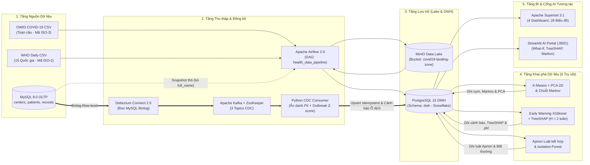
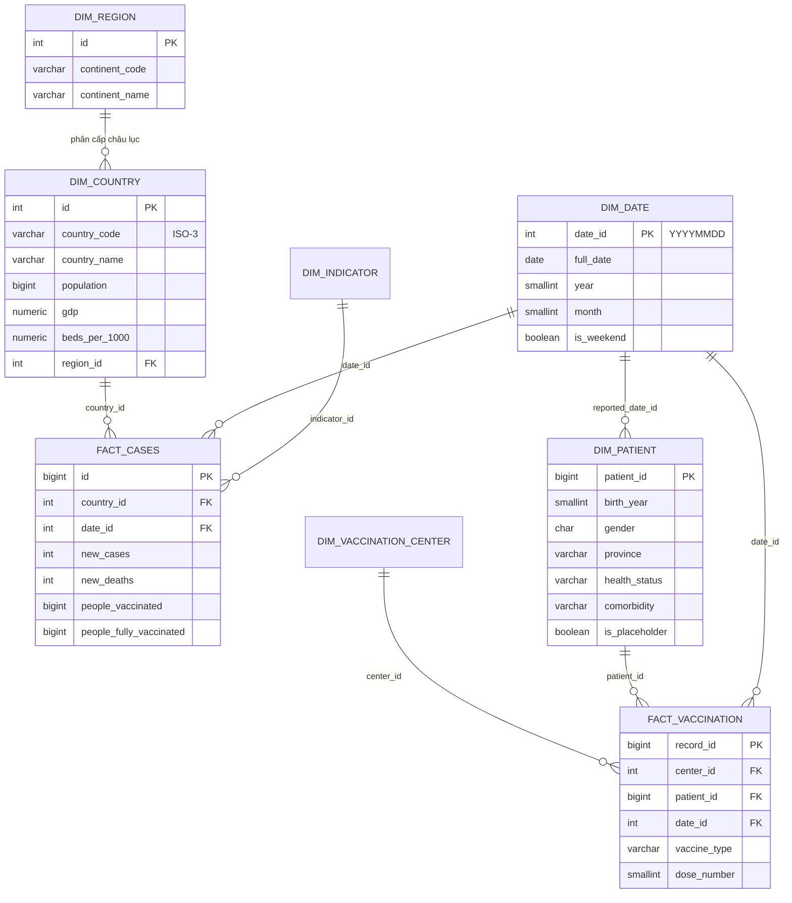

# Giới thiệu Tổng quan Hệ thống — Nền tảng Dữ liệu & Khai phá Dữ liệu Y tế Công cộng (COVID-19)

Tài liệu này trình bày tổng thể mục tiêu, kiến trúc kỹ thuật, mô hình dữ liệu kho (Data Warehouse), cơ chế đồng bộ thời gian thực (CDC) và **5 bài toán Khai phá dữ liệu (Data Mining)** cốt lõi của hệ thống, phục vụ trực tiếp cho việc tìm hiểu hệ thống, viết báo cáo và chuẩn bị slide bảo vệ.

*(Hướng dẫn cài đặt & cổng dịch vụ xem tại [README.md](./README.md); kịch bản thuyết trình trực tiếp xem tại [DEMO.md](./DEMO.md)).*

---

## 1. Bối cảnh & Mục tiêu Hệ thống

Trong giám sát dịch tễ học hiện đại, dữ liệu y tế thường phân mảnh ở nhiều định dạng và tốc độ phát sinh khác nhau: dữ liệu thống kê toàn cầu cập nhật theo lô (batch), danh mục chuẩn của Tổ chức Y tế Thế giới (WHO) khác hệ mã quốc gia, và dữ liệu tiêm chủng/ca bệnh nội bộ phát sinh liên tục theo thời gian thực kèm thông tin nhạy cảm của công dân.

Hệ thống được xây dựng nhằm giải quyết trọn vẹn bài toán từ **Kỹ thuật dữ liệu (Data Engineering)** đến **Khai phá dữ liệu (Data Mining)**:

1. **Hợp nhất đa nguồn dữ liệu thực tế** (OWID toàn cầu, WHO và MySQL OLTP nội bộ) qua kiến trúc kết hợp **Batch ETL + Real-time CDC**.
2. **Bảo vệ quyền riêng tư theo thiết kế (Privacy by Design)**: Tự động loại bỏ thông tin định danh cá nhân (`full_name`, `citizen_hash`) trước khi dữ liệu đi vào Kho dữ liệu phân tích.
3. **Phân cụm xu hướng dịch tễ không giám sát (Unsupervised Clustering — K-Means nâng cao)**: Tự động kiểm định số cụm tối ưu $K$, giải mã tâm cụm để sinh nhãn nghiệp vụ tiếng Việt và giảm chiều bằng **PCA** để trực quan hóa.
4. **Cảnh báo sớm bùng phát dịch có giám sát (Supervised Classification — XGBoost)**: Dự báo trước **2 tuần** nguy cơ bùng phát dịch tại từng quốc gia với cơ chế chia tập thời gian chống rò rỉ dữ liệu (**Purged Time-Series Split**).
5. **Khai phá Chuỗi chuyển dịch cụm (Markov Transition Matrix & Dwell Time) & Luật kết hợp (Association Rule Mining — Apriori / FP-Growth)**: Định lượng xác suất chuyển trạng thái dịch giữa các tuần, thời gian lưu trú trung bình tại từng vùng dịch và phát hiện các tổ hợp `{Nhóm tuổi + Bệnh nền + Tiêm chủng} ⇒ {Tình trạng COVID-19}` có độ nâng (`Lift`) cao.
6. **Phát hiện Bất thường Kép (Isolation Forest Lịch sử + Kafka Streaming Realtime) & Giải thích Cục bộ TreeSHAP**: Tự động gắn cờ 1.130 tuần bất thường toàn cầu, phát hiện ổ dịch cục bộ trên Kafka CDC trong < 3 giây (`Z-score`) và giải thích 3 yếu tố quyết định cảnh báo cho từng quốc gia (`top_reasons_vi`).
7. **Trực quan hóa BI & Cổng AI Tương tác 100% tiếng Việt**: 4 Dashboard Superset (17 Datasets, 28 biểu đồ) kết hợp **Cổng Web AI Streamlit (`http://localhost:8501`)** cho phép mô phỏng What-If trực tiếp trên mô hình XGBoost thật.

---

## 2. Kiến trúc Tổng thể Hệ thống

Hệ thống vận hành hoàn toàn trên nền tảng container hóa (**Docker Compose** gồm 11 dịch vụ), chia làm 5 tầng rõ rệt:



### Vai trò từng thành phần công nghệ

| Tầng | Công nghệ | Vai trò chính trong dự án |
| :--- | :--- | :--- |
| **CSDL Giao dịch (OLTP)** | `MySQL 8.0` | Lưu trữ dữ liệu vận hành nội bộ (`vaccination_centers`, `patients`, `vaccination_records`), bật `binlog` chế độ `ROW`. |
| **Streaming CDC & Outbreak** | `Debezium` + `Kafka` + `Python` | Bắt biến động `INSERT/UPDATE/DELETE` theo thời gian thực (< 2 giây), ẩn danh PII bệnh nhân, đồng thời chạy **Streaming Outbreak Detector** (sliding window Z-score) phát hiện ổ dịch cục bộ ghi vào `dwh.fact_realtime_anomalies` trong < 3 giây. |
| **Data Lake** | `MinIO` (chuẩn S3) | Lưu trữ dữ liệu thô (`Landing Zone`) phân vùng theo nguồn và ngày chạy (`raw/owid/`, `raw/who/`, `raw/oltp/`) phục vụ đối soát và chạy lại. |
| **Điều phối ETL & ML** | `Apache Airflow 2.9` | Tự động hóa chuỗi tác vụ ETL + 5 bài toán Khai phá Dữ liệu (K-Means + PCA, Markov, XGBoost + TreeSHAP, Apriori, Isolation Forest) theo lịch `@daily`. |
| **Data Warehouse** | `PostgreSQL 15` | Lưu trữ kho dữ liệu phân tích theo lược đồ **Snowflake Schema** kết hợp các bảng/view kết quả khai phá dữ liệu và kiểm định mô hình. |
| **Business Intelligence** | `Apache Superset 3.1` | Hiển thị 4 Dashboard tiếng Việt (17 Datasets, 28 biểu đồ), khởi tạo tự động qua REST API (`scripts/init_superset_dashboards.py`). |
| **Cổng AI Tương tác** | `Streamlit` (`ai-portal`, cổng `8501`) | Ứng dụng web 4 tab tiếng Việt cho phép mô phỏng kịch bản What-If trực tiếp trên mô hình XGBoost thật + Waterfall TreeSHAP, tra cứu luật Apriori, dự báo Markov $P^k$ và giám sát bất thường kép. |

---

## 3. Thiết kế Kho Dữ liệu (Snowflake Schema & Data Mining Marts)

Kho dữ liệu trong schema `dwh` được thiết kế tách bạch rõ phần lõi dịch tễ chuẩn hóa theo **Snowflake Schema** (`dim_country` nối phân cấp sang `dim_region`) và các bảng kết quả khai phá dữ liệu:



### Các bảng lưu trữ kết quả Data Mining trong `dwh`

1. **Nhóm bảng Phân cụm K-Means & PCA**:
   - `dwh.fact_weekly_covid_cluster`: Kết quả gán cụm của **56.477** quan sát `(week_start, country_code)`, kèm `cluster_label` và tọa độ giảm chiều `pca_1`, `pca_2`.
   - `dwh.fact_kmeans_evaluation`: Bảng chỉ số kiểm định `K = 2..8` (`inertia`, `silhouette`, `davies_bouldin`, `calinski_harabasz`, `is_selected`, `is_best_silhouette`).
   - `dwh.fact_kmeans_cluster_profile`: Hồ sơ thống kê từng cụm (số lượng, tỷ trọng, trung bình/trung vị ca mắc & tử vong, tâm cụm không gian log gốc, Silhouette trung bình từng cụm).
2. **Nhóm bảng Cảnh báo sớm XGBoost & Giải thích TreeSHAP**:
   - `dwh.fact_early_warning`: Xác suất bùng phát `surge_probability`, ngưỡng quyết định, nhãn dự báo, mức cảnh báo (`HIGH / WATCH / LOW`) và giải thích cục bộ 3 yếu tố chính `top_reasons_vi` (TreeSHAP) cho cả tập `test` và `forecast`.
   - `dwh.fact_early_warning_evaluation`: Bảng đối sánh định lượng 3 mô hình trên cùng tập kiểm thử (`accuracy`, `precision`, `recall`, `f1_score`, `roc_auc`, `pr_auc`, ma trận nhầm lẫn).
   - `dwh.fact_early_warning_feature_importance`: Bảng xếp hạng mức độ đóng góp của 18 đặc trưng đầu vào.
3. **Nhóm bảng Chuỗi Chuyển dịch Cụm Markov & Thời gian Lưu trú**:
   - `dwh.fact_cluster_transition`: Ma trận xác suất chuyển cụm bậc 1 $P(C_{t+1} \mid C_t)$ và phân loại hướng chuyển dịch (*Giữ nguyên*, *Leo thang*, *Hạ nhiệt*).
   - `dwh.fact_cluster_dwell_time`: Thống kê số đợt lưu trú liên tục, thời gian lưu trú trung bình/trung vị/cực đại và xác suất duy trì cụm.
4. **Nhóm bảng Khai phá Luật Kết hợp Bệnh nhân & Tiêm chủng**:
   - `dwh.fact_patient_association_rules`: Lưu Top 40 quy luật kết hợp Apriori / FP-Growth kèm `support`, `confidence`, `lift`, `leverage`, `conviction` và phát biểu tiếng Việt `rule_text_vi`.
5. **Nhóm bảng Phát hiện Bất thường Kép (Lịch sử & Thời gian thực)**:
   - `dwh.fact_covid_anomalies`: Lưu **1.130** tuần bất thường toàn cầu do Isolation Forest cô lập kèm phân loại `anomaly_type_vi` và diễn giải `explanation_vi`.
   - `dwh.fact_realtime_anomalies`: Lưu cảnh báo ổ dịch tức thời từ luồng Kafka CDC (`province`, `confirmed_count`, `baseline_avg`, `z_score`, `severity_vi`, `alert_message_vi`).

### Nguyên tắc Tích hợp Dữ liệu & Bảo mật Đáng chú ý
- **Không trộn sai hệ mã quốc gia**: Dữ liệu OWID dùng mã ISO-3 (`VNM`, `USA`) được nạp vào `dwh.fact_cases`, trong khi bộ WHO dùng mã ISO-2 (`VN`, `US`) được lưu ở bảng độc lập `dwh.fact_who_covid_daily`.
- **Ẩn danh hóa dữ liệu bệnh nhân (PII Anonymization)**: Bảng `patients` ở MySQL chứa `full_name` và `citizen_hash`, nhưng `cdc/consumer.py` cắt bỏ hoàn toàn 2 trường này trước khi ghi sang `dwh.dim_patient`.
- **Xử lý sự kiện lệch thứ tự trên Kafka**: Nếu bản ghi tiêm chủng tới trước bản ghi bệnh nhân, consumer tự tạo dòng tạm `dim_patient(is_placeholder = TRUE)` để bảo toàn khóa ngoại, sau đó tự cập nhật đầy đủ khi bản tin bệnh nhân tới.

---

## 4. Chi tiết Năm Bài toán Khai phá Dữ liệu (Data Mining)

### 4.1. Bài toán 1: Phân cụm Xu hướng Dịch tễ K-Means Nâng cao
*(Mã nguồn: `airflow/dags/weekly_covid_kmeans.py`)*

- **Đơn vị quan sát**: Quốc gia $c$ trong tuần dịch tễ $t$ (tổng cộng **56.477** quan sát thực tế từ năm 2020–2024).
- **Không gian 3 đặc trưng dịch tễ** (đã chuẩn hóa theo quy mô dân số và biến đổi logarit để giảm độ lệch phải của các đợt siêu bùng phát, sau đó chuẩn hóa Z-score bằng `StandardScaler`):
  $$X_1 = \ln\left(1 + \frac{\text{cases}_{c,t}}{\text{pop}_c} \times 10^5\right), \quad X_2 = \ln\left(1 + \frac{\text{deaths}_{c,t}}{\text{pop}_c} \times 10^5\right), \quad X_3 = X_{1(c,t)} - X_{1(c,t-1)}$$
- **Kiểm định số cụm $K \in \{2, \dots, 8\}$**: Tính đồng thời 4 thước đo độc lập (với cỡ mẫu ngẫu nhiên cố định 10.000 dòng cho Silhouette để tối ưu độ phức tạp $O(n^2)$). Hệ thống hỗ trợ cả chọn cố định `K=4` lẫn chế độ tự động `COVID_KMEANS_CLUSTERS=auto` (`K=5` đạt Silhouette cực đại `0,5821`).
- **Hồ sơ cụm & Tự động gắn nhãn**: Các cụm được sắp thứ tự tăng dần theo tỷ lệ mắc trung bình; tâm cụm được biến đổi ngược (`scaler.inverse_transform`) để nhận diện xu hướng (`đang tăng` khi $\Delta \ln > 0.15$, `đang giảm` khi $\Delta \ln < -0.15$, ngược lại là `ổn định`).

| Cụm | Nhãn tự sinh | Số quan sát | Tỉ trọng | Ca mắc TB / 100k | Tử vong TB / 100k | Ý nghĩa dịch tễ thực tế |
| :---: | :--- | ---: | ---: | ---: | ---: | :--- |
| **0** | `Thấp – ổn định` | 35.236 | 62,4% | 0,9 | 0,02 | Kiểm soát tốt / Vùng xanh bình thường |
| **1** | `Trung bình – ổn định` | 14.900 | 26,4% | 136,4 | 0,36 | Lây nhiễm cộng đồng trong tầm kiểm soát |
| **2** | `Cao – đang tăng` | 770 | 1,4% | 332,1 | 0,39 | Đợt bùng phát tăng vọt đột biến (+705%/tuần) |
| **3** | `Rất cao – ổn định` | 5.571 | 9,9% | 442,4 | 4,14 | Đỉnh dịch kéo dài / Áp lực tử vong cao |

---

### 4.2. Bài toán 2: Cảnh báo Sớm Bùng phát Dịch bằng XGBoost
*(Mã nguồn: `airflow/dags/covid_early_warning.py`)*

- **Định nghĩa bài toán phân lớp nhị phân**: Tại tuần $t$ của quốc gia $c$, dự đoán nhãn bùng phát sau $H = 2$ tuần:
  $$y_{c,t} = \mathbb{I}\Big(\text{rate}_{c, t+H} \ge 1.5 \times \text{rate}_{c,t} \;\wedge\; \text{rate}_{c, t+H} \ge 10\Big)$$
- **18 đặc trưng nhân quả nghiêm ngặt** (chỉ sử dụng thông tin $\le t$, tuyệt đối không nhìn tương lai):
  - *Mức độ & Trễ*: `log_cases_per_100k`, trễ 1–3 tuần, trung bình & độ lệch chuẩn trượt 4 tuần.
  - *Động lượng*: tốc độ tăng 1 tuần, 2 tuần và **gia tốc lây nhiễm** (`growth_accel`).
  - *Tử vong*: `log_deaths_per_100k`, tăng trưởng tử vong 1 tuần, tỷ lệ tử vong/ca mắc trượt 4 tuần (`cfr_roll4`).
  - *Miễn dịch & Bối cảnh*: tỷ lệ tiêm $\ge 1$ mũi và tiêm đủ (`cummax / population`), chu kỳ mùa vụ (`week_sin`, `week_cos`), xu hướng tăng trung bình toàn cầu cùng tuần và `cluster_id` từ K-Means.
- **Chia tập thời gian có khoảng trống chống rò rỉ (Purged Time Split)**:
  - Tập huấn luyện chỉ lấy các tuần $t < \text{cutoff} - H$; tập kiểm thử lấy $t \ge \text{cutoff}$; $H$ tuần mới nhất của mỗi quốc gia đưa vào tập dự báo thực tế (`forecast`).
  - Tối ưu ngưỡng báo động theo **F1-Score** trên tập validation (15% tuần cuối của tập train) và cân bằng lớp hiếm bằng `scale_pos_weight`.
- **Kết quả thực nghiệm độc lập** (44.520 mẫu huấn luyện / 11.006 mẫu kiểm thử):

| Mô hình | Ngưỡng tối ưu | Precision | Recall | F1-Score | ROC-AUC | PR-AUC (Lớp hiếm) |
| :--- | :---: | :---: | :---: | :---: | :---: | :---: |
| **XGBoost (Mô hình chính)** | **0,64** | **0,244** | 0,663 | **0,356** | **0,925** | **0,270** |
| Hồi quy Logistic (`balanced`) | 0,40 | 0,173 | **0,750** | 0,282 | 0,876 | 0,165 |
| Luật cơ sở (Tăng tuần trước $\ge 25\%$) | 0,50 | 0,104 | 0,347 | 0,161 | 0,728 | 0,070 |

*(Kiểm chứng Ablation khi loại bỏ `cluster_id` khỏi XGBoost cho kết quả `ROC-AUC = 0,926`, `PR-AUC = 0,264`, `F1 = 0,355` — khẳng định mô hình hoàn toàn trung thực, không bị rò rỉ thông tin từ tâm cụm).*

---

### 4.3. Bài toán 3: Khai phá Chuỗi Chuyển dịch Cụm Dịch tễ (Markov Transition & Dwell Time)
*(Mã nguồn: `airflow/dags/covid_cluster_transitions.py`)*

- **Ma trận xác suất chuyển trạng thái Markov bậc 1**: Trên chuỗi tuần liên tiếp của từng quốc gia, hệ thống ước lượng xác suất chuyển từ cụm $i$ ở tuần $t$ sang cụm $j$ ở tuần $t+1$:
  $$P(C_{t+1} = j \mid C_t = i) = \frac{N(i \to j)}{\sum_{k} N(i \to k)}$$
  Mỗi bước chuyển được phân loại tự động thành: *Giữ nguyên mức dịch* ($i = j$), *Leo thang* ($j > i$) hoặc *Hạ nhiệt* ($j < i$), lưu tại `dwh.fact_cluster_transition`.
- **Phân tích Thời gian lưu trú liên tục (Dwell Time)**: Đo độ dài các đợt (episodes) một quốc gia nằm liên tiếp trong cùng một cụm trước khi chuyển sang cụm khác (`dwh.fact_cluster_dwell_time`), qua đó xác định một đợt khủng hoảng ở vùng *Rất cao* kéo dài trung bình bao nhiêu tuần.

---

### 4.4. Bài toán 4: Khai phá Luật Kết hợp trên Hồ sơ Bệnh nhân & Tiêm chủng (Apriori / FP-Growth)
*(Mã nguồn: `airflow/dags/patient_association_rules.py`)*

- **Thiết lập giao dịch (Transactions)**: Mỗi hồ sơ bệnh nhân ẩn danh trong `dwh.dim_patient` kết hợp với tổng số mũi tiêm và loại vắc-xin trong `dwh.fact_vaccination` tạo thành một giao dịch gồm các hạng mục rời rạc: `{Nhóm tuổi, Giới tính, Bệnh nền, Trạng thái số mũi tiêm, Loại vắc-xin} ⇒ {Kết cục sức khỏe}`.
- **Các độ đo đánh giá luật $A \Rightarrow B$**:
  $$\text{Support}(A \Rightarrow B) = P(A \cup B), \quad \text{Confidence}(A \Rightarrow B) = P(B \mid A), \quad \text{Lift}(A \Rightarrow B) = \frac{P(B \mid A)}{P(B)}$$
  kèm theo **Leverage** và **Conviction**, lưu trữ Top 40 luật mạnh nhất vào `dwh.fact_patient_association_rules`.

---

### 4.5. Bài toán 5: Phát hiện Bất thường (Isolation Forest + Kafka Realtime) & Giải thích TreeSHAP
*(Mã nguồn: `airflow/dags/covid_anomaly_detection.py`, `cdc/consumer.py`, `portal/app.py`)*

- **Isolation Forest trên 56.477 tuần–quốc gia**: Phát hiện **1.130 tuần bất thường** dựa trên 5 đặc trưng (`log_cases`, `log_deaths`, `case_z_score`, `death_z_score`, `cfr_weekly`), tự động phân loại thành 3 nhóm: *Nhiễu dồn / hiệu chỉnh báo cáo* (`570`), *Tử vong tăng dị thường* (`532`) và *Đột biến ca mắc cục bộ* (`28`), lưu tại `dwh.fact_covid_anomalies`.
- **Phát hiện Ổ dịch Realtime trên Kafka CDC**: Lớp `StreamingOutbreakDetector` giám sát cửa sổ trượt `300s` các sự kiện `CONFIRMED_COVID` trực tuyến theo từng tỉnh/thành; khi vượt ngưỡng bùng phát tự động ghi cảnh báo đỏ kèm `Z-score` vào `dwh.fact_realtime_anomalies` và kích hoạt biểu ngữ trên Cổng AI (`http://localhost:8501`).
- **Giải thích Cục bộ TreeSHAP (`top_reasons_vi`)**: Sử dụng `pred_contribs=True` tích hợp sẵn của XGBoost để sinh tự động 3 nguyên nhân hàng đầu giải thích xác suất cảnh báo của từng quốc gia và vẽ biểu đồ tương tác khi kéo thanh trượt What-If trên **Streamlit AI Portal**.

---

## 5. Hệ thống 4 Dashboard Superset (28 Biểu đồ) & Cổng Web AI Tương tác

Toàn bộ giao diện BI tại `http://localhost:8089` (17 Dataset Views, 28 biểu đồ) được khởi tạo và Việt hóa tự động qua REST API (`scripts/init_superset_dashboards.py`):

1. **Tổng quan Phân cụm Dịch tễ COVID-19 Toàn cầu (4 biểu đồ)** (`/superset/dashboard/covid19-kmeans-clusters/`): Góc nhìn tổng thể mối quan hệ ca mắc – tử vong – quy mô dân số và tỷ trọng giữa 4 nhóm xu hướng dịch tễ.
2. **Phân tích Phân cụm Dịch tễ — Đánh giá Số cụm K, PCA & Chuyển cụm Markov (8 biểu đồ)** (`/superset/dashboard/covid19-kmeans-mining/`): Biểu đồ Khuỷu tay, Silhouette/Davies–Bouldin, mặt phẳng PCA 2D, bảng hồ sơ cụm, diễn biến tuần, Ma trận xác suất chuyển dịch cụm Markov và bảng Thời gian lưu trú Dwell Time.
3. **Hệ thống Cảnh báo Sớm Bùng phát (XGBoost + TreeSHAP) & Bất thường (Isolation Forest) (7 biểu đồ)** (`/superset/dashboard/covid19-early-warning/`): Bản đồ thế giới cảnh báo sớm 2 tuần tới, đối sánh 3 mô hình, Top 10 yếu tố ảnh hưởng, bảng xếp hạng quốc gia kèm lý do TreeSHAP, biểu đồ Donut và bảng chi tiết các tuần bất thường Isolation Forest.
4. **Giám sát Thời gian thực & Khai phá Luật Kết hợp — Bệnh nhân Ẩn danh & Tiêm chủng (9 biểu đồ)** (`/superset/dashboard/covid19-cdc-patients-vaccination/`): Thẻ KPI thời gian thực, ca bệnh theo độ tuổi, cơ cấu bệnh nền, vắc-xin theo độ tuổi, thống kê Tỉnh / Thành phố, Top 10 & bảng Luật kết hợp Apriori và bảng Cảnh báo ổ dịch bất thường thời gian thực từ luồng Kafka CDC.
5. **Cổng Web AI Tương tác Streamlit (`http://localhost:8501` — 4 Tab)**: Cho phép người dùng kéo thanh trượt mô phỏng What-If trực tiếp trên mô hình XGBoost thật + biểu đồ TreeSHAP, tra cứu nguy cơ cá nhân theo luật Apriori, xem quỹ đạo quốc gia + dự phóng Markov $P^k$ và theo dõi cảnh báo ổ dịch Kafka theo giờ Việt Nam.

---

## 6. Cấu trúc Thư mục Mã nguồn Chính

```text
BTL-covid19/
├── airflow/
│   ├── dags/
│   │   ├── health_data_pipeline.py          # DAG điều phối ETL + 5 mô hình Data Mining
│   │   ├── weekly_covid_kmeans.py           # K-Means K=2..8, hồ sơ cụm tự sinh & PCA 2D
│   │   ├── covid_cluster_transitions.py     # Chuỗi chuyển dịch cụm Markov & Dwell Time
│   │   ├── covid_early_warning.py           # Cảnh báo sớm XGBoost, Purged Split & TreeSHAP
│   │   ├── patient_association_rules.py     # Khai phá Luật kết hợp Apriori / FP-Growth
│   │   └── covid_anomaly_detection.py       # Phát hiện tuần bất thường bằng Isolation Forest
│   └── tests/                               # 17 Unit tests kiểm định 5 mô hình ML & chống rò rỉ
├── cdc/
│   ├── consumer.py                          # Kafka CDC consumer (ẩn danh PII & Outbreak Z-score)
│   └── test_consumer.py                     # 11 Unit tests kiểm định CDC, Placeholder & Outbreak
├── portal/
│   ├── Dockerfile                           # Container cổng tương tác AI (ai-portal, port 8501)
│   └── app.py                               # Ứng dụng Streamlit 4 tab kết nối DWH & XGBoost .pkl
├── config/
│   ├── debezium/                            # Cấu hình connector MySQL v2
│   ├── mysql/                               # Cấu hình binlog MySQL OLTP
│   └── superset/                            # Cấu hình bảo mật & tính năng Apache Superset
├── scripts/
│   ├── sql/
│   │   ├── init-oltp.sql                    # Khởi tạo schema & dữ liệu gốc MySQL OLTP
│   │   ├── init-dwh.sql                     # Khởi tạo Snowflake Schema trên PostgreSQL DWH
│   │   └── upgrade-dwh.sql                  # Migration idempotent cho toàn bộ bảng & 17 Views tiếng Việt
│   ├── seed_oltp_data.py                    # Sinh hàng nghìn bệnh nhân & mũi tiêm giả lập cho OLTP
│   ├── init_superset_dashboards.py          # Tự động tạo & Việt hóa 17 Dataset, 28 Chart, 4 Dashboard
│   ├── demo_cdc.ps1 / demo_cdc_stream.py    # Kịch bản minh họa đồng bộ CDC ẩn danh (< 2 giây)
│   ├── demo_realtime_outbreak.ps1           # Kịch bản giả lập ổ dịch bùng phát tức thời trên Kafka (< 3 giây)
│   └── demo_kmeans.py                       # Kịch bản truy vấn & trình diễn kết quả Data Mining trên CLI
├── baocao/
│   ├── baocao-datamining.docx               # Báo cáo học thuật đầy đủ theo mẫu PTIT
│   └── slide-datamining.pptx                # Bộ 22 slide thuyết trình bảo vệ đồ án
├── docker-compose.yml                       # Định nghĩa 11 dịch vụ container toàn hệ thống
├── GIOI_THIEU_HE_THONG.md / .docx           # Tài liệu giới thiệu tổng quan kiến trúc & thuật toán
├── DEMO.md                                  # Kịch bản thuyết trình & hỏi đáp bảo vệ đồ án
└── README.md                                # Hướng dẫn cài đặt, ánh xạ cổng & vận hành nhanh
```
